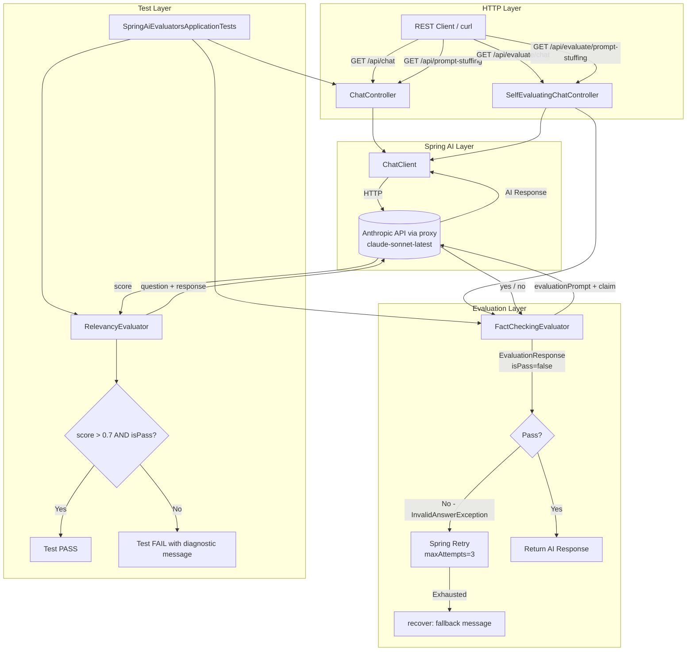

# Spring AI Evaluators

A Spring Boot application demonstrating how to use the **Spring AI Evaluator API** to automatically assess the quality of AI-generated responses — both in integration tests and at runtime. It implements two core evaluation strategies: **relevancy checking** (is the response on-topic?) and **fact-checking** (is the response factually correct?), with a self-healing retry pattern when evaluation fails.

---

## Table of Contents

1. [Overview](#overview)
2. [Key Features](#key-features)
3. [Technology Stack](#technology-stack)
4. [Prerequisites](#prerequisites)
5. [Configuration](#configuration)
6. [Project Structure](#project-structure)
7. [Architecture](#architecture)
8. [Evaluator Details](#evaluator-details)
9. [Execution Flows](#execution-flows)
10. [API Documentation](#api-documentation)
11. [Core Components and Classes](#core-components-and-classes)
12. [How Spring AI Evaluators Work (LLM-as-Judge)](#how-spring-ai-evaluators-work-llm-as-judge)
13. [Prompt Templates](#prompt-templates)
14. [How to Trigger Evaluation](#how-to-trigger-evaluation)
15. [Interpreting Results](#interpreting-results)
16. [Running the Application and Tests](#running-the-application-and-tests)
17. [Example Usage with Sample Results](#example-usage-with-sample-results)
18. [Testing](#testing)
19. [Error Handling](#error-handling)
20. [Design Decisions](#design-decisions)
21. [Limitations](#limitations)
22. [Possible Improvements](#possible-improvements)
23. [Troubleshooting](#troubleshooting)
24. [Learning Notes / Key Takeaways](#learning-notes--key-takeaways)
25. [Glossary](#glossary)
26. [References](#references)
27. [License](#license)

---

## Overview

### Why AI Evaluation Matters

Large Language Models are probabilistic: the same question can yield different answers across calls. In production systems, a response that is:

- Off-topic (not relevant to the question asked)
- Factually incorrect (contradicts known facts or the provided context)

...is worse than no response at all. Manual review at scale is impractical. **AI evaluation** — sometimes called "LLM-as-judge" — uses a second LLM call to score or validate the primary LLM response against defined criteria. This project demonstrates both:

1. **Offline evaluation** via integration tests: validate responses before shipping a feature.
2. **Online / runtime evaluation**: validate responses per request and retry automatically when the evaluation fails.

### Purpose of This Project

This is a learning and demonstration project that shows:

- How to configure and use Spring AI's built-in `RelevancyEvaluator` and `FactCheckingEvaluator`.
- How to wire evaluation into integration tests using JUnit 5 and AssertJ.
- How to combine evaluation with Spring Retry to create a self-healing endpoint that retries when the AI answer fails a fact-check.
- How to use prompt-stuffing / RAG context in evaluation (passing retrieved documents to the evaluator).

---

## Key Features

- **RelevancyEvaluator**: Scores whether an AI response is relevant to the user's question, with a configurable minimum score threshold.
- **FactCheckingEvaluator**: Checks whether an AI response is factually correct against a custom evaluator prompt. Can optionally receive context documents (for RAG scenarios).
- **Self-evaluating REST endpoint**: Uses `FactCheckingEvaluator` inline, throws `InvalidAnswerException` on failure, and leverages `@Retryable` / `@Recover` from Spring Retry to handle up to 3 retry attempts before returning a fallback response.
- **Prompt-stuffing / RAG simulation**: An HR Policy system prompt is injected as the LLM's context to demonstrate domain-constrained responses.
- **Configurable scoring threshold**: Minimum relevancy score is externalised to a test property (`test.relevancy.min-score`, default `0.7`).
- **Custom fact-check prompt template**: The evaluator prompt is stored as a `.st` (StringTemplate) file and injected at construction time, making it easy to modify without recompiling.

---

## Technology Stack

| Technology | Version | Purpose |
|---|---|---|
| Java | 17 | Language version |
| Spring Boot | 4.1.1 | Application framework |
| Spring AI | 2.0.1 | AI abstraction, evaluators, chat client |
| Spring AI Anthropic Starter | (BOM-managed) | Anthropic Claude model integration |
| Spring Retry | 2.0.12 | `@Retryable` / `@Recover` for self-healing |
| Spring Aspects | (Boot-managed) | AOP support required by Spring Retry |
| Spring Boot Web MVC | (Boot-managed) | REST controllers |
| JUnit 5 | (Boot-managed) | Testing framework |
| AssertJ | (Boot-managed) | Fluent assertions in tests |
| Maven | Wrapper included | Build tool |

**LLM Provider**: Anthropic Claude — model `claude-sonnet-latest`.

---

## Prerequisites

- **JDK 17** or later
- **Maven** (or use the included `mvnw` / `mvnw.cmd` wrapper)
- **Anthropic API key** — set as the environment variable `ANTHROPIC_API_KEY` (obtain from [console.anthropic.com](https://console.anthropic.com))

---

## Configuration

### `src/main/resources/application.properties`

```properties
spring.application.name=SpringAI-Evaluators

# Colored console logging
logging.pattern.console=%green(%d{HH:mm:ss.SSS}) %blue(%-5level) %red([%thread]) %yellow(%logger{15}) - %msg%n

# Debug-level logging for Spring AI advisor chain (logs prompts and responses)
logging.level.org.springframework.ai.chat.client.advisor=DEBUG

# Anthropic configuration
spring.ai.anthropic.base-url=https://api.anthropic.com
spring.ai.anthropic.api-key=${ANTHROPIC_API_KEY}
spring.ai.anthropic.chat.options.model=claude-sonnet-latest
```

**Key points:**

- `ANTHROPIC_API_KEY` must be set as an environment variable before running the app or tests. Obtain it from [console.anthropic.com](https://console.anthropic.com). Never commit the real key.
- `logging.level.org.springframework.ai.chat.client.advisor=DEBUG` enables `SimpleLoggerAdvisor` output that shows the full prompt sent to and the full response received from the LLM — useful during development.

### Configurable Test Property

| Property | Default | Description |
|---|---|---|
| `test.relevancy.min-score` | `0.7` | Minimum acceptable relevancy score (float 0–1) for relevancy test assertions |

Override it in your test run with `-Dtest.relevancy.min-score=0.8`.

---

## Project Structure

```
spring-ai-evaluators/
├── pom.xml                                          # Maven build descriptor
├── mvnw / mvnw.cmd                                  # Maven wrapper scripts
├── src/
│   ├── main/
│   │   ├── java/com/springai/evaluatorstesting/
│   │   │   ├── SpringAiEvaluatorsApplication.java  # Entry point (@SpringBootApplication, @EnableRetry)
│   │   │   ├── controller/
│   │   │   │   ├── ChatController.java             # Basic chat + prompt-stuffing endpoints
│   │   │   │   └── SelfEvaluatingChatController.java  # Self-evaluating + retryable endpoint
│   │   │   └── exception/
│   │   │       └── InvalidAnswerException.java     # Thrown when fact-check fails
│   │   └── resources/
│   │       ├── application.properties              # App configuration
│   │       └── promptTemplates/
│   │           ├── factcheck.st                    # Custom prompt for FactCheckingEvaluator
│   │           └── hrPolicy.st                     # System prompt for HR Policy domain
│   └── test/
│       └── java/com/springai/evaluatorstesting/
│           └── SpringAiEvaluatorsApplicationTests.java  # Integration tests with evaluators
```

---

## Architecture



---

## Evaluator Details

### 1. RelevancyEvaluator

**What it evaluates**: Whether an AI response is relevant and on-topic relative to the question asked.

**Used in**: Integration tests only (`SpringAiEvaluatorsApplicationTests`).

**Class**: `org.springframework.ai.chat.evaluation.RelevancyEvaluator`

**How it's constructed**:
```java
this.relevancyEvaluator = new RelevancyEvaluator(chatClientBuilder);
```

**Inputs required**:
```java
EvaluationRequest evaluationRequest = new EvaluationRequest(question, aiResponse);
EvaluationResponse evaluationResponse = relevancyEvaluator.evaluate(evaluationRequest);
```
The two-argument constructor of `EvaluationRequest` takes the original question and the AI response to evaluate.

**Scoring mechanism**: The evaluator issues an internal LLM call using its built-in prompt. Spring AI's `RelevancyEvaluator` uses the Claude model (the same `ChatClient` it was built with) to produce a numeric score between 0.0 and 1.0.

**Thresholds**:
- `isPass()` — determined internally by Spring AI (implementation-specific, likely score > some built-in cutoff).
- A configurable project-level threshold is applied as a second assertion: `score > minRelevancyScore` (default `0.7`).

**Pass/fail logic in tests**:
```java
assertThat(evaluationResponse.isPass()).isTrue()
assertThat(evaluationResponse.getScore()).isGreaterThan(minRelevancyScore)
```
Both assertions must pass for the test to succeed.

---

### 2. FactCheckingEvaluator

**What it evaluates**: Whether an AI response is factually correct. Can optionally evaluate against retrieved documents (RAG context).

**Used in**:
- Integration tests (`SpringAiEvaluatorsApplicationTests`) — three test scenarios.
- Runtime endpoint (`SelfEvaluatingChatController`) — validates each response before returning it.

**Class**: `org.springframework.ai.chat.evaluation.FactCheckingEvaluator`

**How it's constructed** (uses custom prompt template):
```java
this.factCheckingEvaluator = FactCheckingEvaluator.builder(chatClientBuilder)
    .evaluationPrompt(factCheckTemplate.getContentAsString(Charset.defaultCharset()))
    .build();
```

**Inputs required**:

| Scenario | EvaluationRequest Constructor |
|---|---|
| No context documents | `new EvaluationRequest(question, aiResponse)` |
| With RAG context | `new EvaluationRequest(question, List.of(new Document(contextText)), aiResponse)` |

**Scoring mechanism**: The evaluator sends the claim and (optionally) document context to the LLM using the custom `factcheck.st` prompt. The LLM is instructed to respond with only `"yes"` or `"no"`. Spring AI maps this to `isPass()`.

- `isPass() = true` when LLM responds `"yes"` (claim is factually supported).
- `isPass() = false` when LLM responds `"no"` (claim is factually incorrect).

There is no float score from `FactCheckingEvaluator` — it is a binary pass/fail evaluator.

**Pass/fail logic**:
```java
// In tests
assertThat(response.isPass()).isTrue()

// In runtime controller
if (!evaluationResponse.isPass()) {
    throw new InvalidAnswerException(message, answer);
}
```

---

## Execution Flows

### Flow 1 — Test-Based Offline Evaluation

```
JUnit 5 test invokes ChatController.chat() or promptStuffing()
  → ChatClient sends question to claude-sonnet-latest
  → LLM returns aiResponse
  → EvaluationRequest built from (question [, documents], aiResponse)
  → RelevancyEvaluator or FactCheckingEvaluator calls LLM-as-judge
  → EvaluationResponse returned with isPass() and optionally getScore()
  → AssertJ assertions verify pass status and (for relevancy) score threshold
  → Test passes or fails with a structured diagnostic message
```

### Flow 2 — Runtime Self-Evaluating Endpoint

```
HTTP GET /api/evaluate/chat?message=<question>
  → SelfEvaluatingChatController.chat() called
  → ChatClient sends question to claude-sonnet-latest
  → LLM returns aiResponse
  → validateAnswer(question, answer) called
      → EvaluationRequest built
      → FactCheckingEvaluator.evaluate() calls LLM-as-judge
      → If isPass() == false: InvalidAnswerException thrown
          → Spring Retry intercepts: retry attempt (up to maxAttempts=3)
          → On 3rd failure: @Recover method returns fallback message
      → If isPass() == true: aiResponse returned to caller
```

**Important note on the current demo code**: `SelfEvaluatingChatController.chat()` deliberately passes the hardcoded wrong answer `"The capital of India is London"` to `validateAnswer()` instead of the actual `aiResponse`. This forces the evaluator to always fail, demonstrating the retry and recovery mechanism. The `aiResponse` is commented out: `/*aiResponse*/`. This is intentional for demonstration; in production usage you would pass `aiResponse`.

---

## API Documentation

### `ChatController` — `/api`

#### `GET /api/chat`

Sends a free-form message to Claude with no system context.

| Parameter | Type | Required | Description |
|---|---|---|---|
| `message` | query string | Yes | The question or prompt to send |

**Response**: Plain text string (the LLM's response).

**Example**:
```bash
curl "http://localhost:8080/api/chat?message=What+is+the+capital+of+India"
```

---

#### `GET /api/prompt-stuffing`

Sends a message to Claude with the HR Policy document injected as the system prompt (simulates a simple RAG / prompt-stuffing approach).

| Parameter | Type | Required | Description |
|---|---|---|---|
| `message` | query string | Yes | HR policy-related question |

**Response**: Plain text string limited to HR policy topics.

**Example**:
```bash
curl "http://localhost:8080/api/prompt-stuffing?message=How+many+paid+leaves+do+I+get"
```

---

### `SelfEvaluatingChatController` — `/api/evaluate`

#### `GET /api/evaluate/chat`

Sends a message to Claude, evaluates the factual correctness of the response using `FactCheckingEvaluator`, and retries up to 3 times on failure.

**Note**: Currently uses a hardcoded wrong answer for demo purposes — see [Design Decisions](#design-decisions).

| Parameter | Type | Required | Description |
|---|---|---|---|
| `message` | query string | Yes | Question to ask the LLM |

**Response**:
- On success: the LLM's response (plain text).
- After 3 failures: `"I'm sorry, I couldn't answer your question. Please try rephrasing it."`

---

#### `GET /api/evaluate/prompt-stuffing`

Sends an HR policy question to Claude with system prompt context. No evaluation is applied at runtime in this endpoint.

| Parameter | Type | Required | Description |
|---|---|---|---|
| `message` | query string | Yes | HR policy-related question |

**Response**: Plain text HR policy answer.

---

## Core Components and Classes

### `SpringAiEvaluatorsApplication`

- Entry point annotated with `@SpringBootApplication` and `@EnableRetry`.
- `@EnableRetry` activates Spring Retry's AOP proxy mechanism, which is required for `@Retryable` annotations on controller methods to function.

---

### `ChatController`

- Builds a `ChatClient` with `SimpleLoggerAdvisor` as a default advisor (logs all prompts and responses at DEBUG level).
- Injects `hrPolicy.st` as a `Resource` to use as a system prompt.
- Provides non-evaluating endpoints used both directly and by integration tests.

---

### `SelfEvaluatingChatController`

- Builds both a `ChatClient` and a `FactCheckingEvaluator` in its constructor from the same `ChatClient.Builder`.
- Uses `@Retryable(retryFor = InvalidAnswerException.class, maxAttempts = 3)` on the `chat()` method.
- The private `validateAnswer()` method encapsulates the evaluation + exception-throwing logic.
- `@Recover` method `recover(InvalidAnswerException)` returns a user-friendly fallback message.

---

### `InvalidAnswerException`

- `RuntimeException` subclass.
- Carries the question and incorrect answer in its message: `"Answer check failed: The answer "<answer>" is not correct for the question "<question>"."`
- Used as the trigger type for Spring Retry.

---

### `SpringAiEvaluatorsApplicationTests`

- `@SpringBootTest` — loads the full application context.
- `@TestInstance(Lifecycle.PER_CLASS)` — single test instance, allowing `@BeforeEach` to initialise evaluators once per instance rather than per method.
- Three evaluation test methods (see [Testing](#testing)).

---

## How Spring AI Evaluators Work (LLM-as-Judge)

Spring AI's evaluator API is based on the "LLM-as-judge" pattern:

1. The evaluator takes `EvaluationRequest` containing the original question, optional context documents, and the AI response to evaluate.
2. The evaluator constructs a **meta-prompt** (either built-in or custom-supplied) that frames the evaluation task.
3. The evaluator calls the same (or a separate) LLM with this meta-prompt.
4. The LLM's output is parsed to determine `isPass()` and (for some evaluators) a float `score`.
5. The result is returned as `EvaluationResponse`.

**Key interface**:
```java
public interface Evaluator {
    EvaluationResponse evaluate(EvaluationRequest evaluationRequest);
}
```

**Key classes**:
```
EvaluationRequest(String userText, String aiResponse)
EvaluationRequest(String userText, List<Document> context, String aiResponse)

EvaluationResponse.isPass()    // boolean
EvaluationResponse.getScore()  // float (0.0–1.0); may be 0 for binary evaluators
```

Both `RelevancyEvaluator` and `FactCheckingEvaluator` implement the `Evaluator` interface. They share the same underlying `ChatClient` (and thus the same LLM model) used for the primary chat calls.

---

## Prompt Templates

### `factcheck.st` (FactCheckingEvaluator custom prompt)

Location: `src/main/resources/promptTemplates/factcheck.st`

```
Evaluate whether the following claim is factually correct.

Instructions:
1. If the document fully supports the claim, respond with "yes".
2. If the document partially supports the claim, use your own general knowledge to verify the remaining information.
3. If the document contradicts any part of the claim, respond with "no".
4. If no document is provided, rely entirely on your own general knowledge.
5. Respond only with "yes" or "no". Do not provide explanations.

Document:
{document}

Claim:
{claim}
```

**Template variables** (resolved by Spring AI internally):
- `{document}`: the text of any `Document` objects passed in `EvaluationRequest`; empty string if none.
- `{claim}`: the AI response being evaluated (not the original question).

---

### `hrPolicy.st` (System prompt for HR domain)

Location: `src/main/resources/promptTemplates/hrPolicy.st`

An in-context knowledge base injected as the system prompt. Simulates a RAG retrieval result being stuffed into the prompt. Contains HR policy facts such as:
- 18 days paid leave annually
- Up to 8 unused days carry-over
- Standard hours: 9 AM – 6 PM, Monday–Friday
- 30-day notice period
- Maternity leave: 6 months; Paternity leave: 2 weeks
- Benefits: health insurance, provident fund, annual health checkup

---

## How to Trigger Evaluation

### Via Integration Tests (primary usage)

```bash
# Run all tests
./mvnw test

# Run only evaluation tests
./mvnw test -Dtest=SpringAiEvaluatorsApplicationTests

# Override relevancy threshold
./mvnw test -Dtest.relevancy.min-score=0.8
```

### Via REST API (runtime self-evaluation)

```bash
# Normal chat (no evaluation)
curl "http://localhost:8080/api/chat?message=What+is+the+capital+of+India"

# Self-evaluating endpoint (with retry on fact-check failure)
curl "http://localhost:8080/api/evaluate/chat?message=What+is+the+capital+of+India"
```

---

## Interpreting Results

### From Tests

| Assertion | Meaning when failed |
|---|---|
| `evaluationResponse.isPass() == true` | The LLM-judge decided the response was not relevant / not factually correct |
| `evaluationResponse.getScore() > 0.7` | The relevancy score was below the configured threshold |

The tests include detailed failure messages with the question, response, and context to aid debugging:
```
========================================
The answer was not considered relevant.
Question: "what is the capital of India ?"
Response: "<actual LLM response>"
========================================
```

### From the Self-Evaluating Endpoint

| Response | Interpretation |
|---|---|
| Normal AI answer | Evaluation passed on attempt 1, 2, or 3 |
| `"I'm sorry, I couldn't answer your question. Please try rephrasing it."` | All 3 retry attempts failed evaluation |

Note: With the current demo hardcoding (`"The capital of India is London"`), the `/api/evaluate/chat` endpoint will **always** exhaust retries and return the fallback message because the wrong answer always fails the fact-check.

---

## Running the Application and Tests

### Start the Application

```bash
# Set your API key
export ANTHROPIC_API_KEY=your_anthropic_api_key_here

# Run with Maven wrapper (Linux/Mac)
./mvnw spring-boot:run

# Run with Maven wrapper (Windows)
mvnw.cmd spring-boot:run
```

The application starts on `http://localhost:8080` by default.

### Run Tests

```bash
# Ensure ANTHROPIC_API_KEY is set (tests call the real Anthropic API)
export ANTHROPIC_API_KEY=your_anthropic_api_key_here

./mvnw test
```

All three integration tests will make live LLM API calls and may take up to 30 seconds each (enforced by `@Timeout(value = 30)`).

### Build Without Tests

```bash
./mvnw package -DskipTests
java -jar target/evaluators-testing-0.0.1-SNAPSHOT.jar
```

---

## Example Usage with Sample Results

### Test: Relevancy Evaluation

```
Question: "what is the capital of India ?"
AI Response: "The capital of India is New Delhi..."
→ RelevancyEvaluator score: ~0.95  (hypothetical)
→ isPass(): true
→ Test PASSES
```

### Test: Fact-Checking Without Context

```
Question: "Who discovered the law of universal gravitation?"
AI Response: "Sir Isaac Newton discovered the law of universal gravitation in 1687..."
→ FactCheckingEvaluator (no documents)
→ LLM-judge prompt: "Claim: Sir Isaac Newton discovered..."
→ LLM-judge responds: "yes"
→ isPass(): true
→ Test PASSES
```

### Test: Fact-Checking With RAG Context

```
Question: "How many paid leaves do employees get annually?"
AI Response: "According to our HR policy, employees receive 18 days of paid leave annually."
Context: hrPolicy.st (contains "18 days of paid leave annually")
→ FactCheckingEvaluator (with Document context)
→ LLM-judge matches claim against HR policy document
→ LLM-judge responds: "yes"
→ isPass(): true
→ Test PASSES
```

### Runtime: Self-Evaluating Endpoint (demo mode)

```
GET /api/evaluate/chat?message=What+is+the+capital+of+India

Attempt 1: AI answers "New Delhi". Evaluator checks "The capital of India is London" → "no" → InvalidAnswerException
Attempt 2: Same (retried) → InvalidAnswerException
Attempt 3: Same → InvalidAnswerException
@Recover: returns "I'm sorry, I couldn't answer your question. Please try rephrasing it."
```

---

## Testing

### Test Class: `SpringAiEvaluatorsApplicationTests`

| Test Method | Evaluator Used | Description |
|---|---|---|
| `evaluateChatControllerResponseRelevancy` | `RelevancyEvaluator` | Calls `ChatController.chat("what is the capital of India ?")`, checks relevancy pass and score > 0.7 |
| `evaluateFactAccuracyForGravityQuestion` | `FactCheckingEvaluator` | Calls `ChatController.chat("Who discovered the law of universal gravitation?")`, checks fact-check pass (no context documents) |
| `evaluateHrPolicyAnswerWithRagContext` | `FactCheckingEvaluator` | Calls `ChatController.promptStuffing("How many paid leaves...")`, passes hrPolicy.st as context document, checks fact-check pass |

All tests:
- Require a live Anthropic API connection.
- Have a 30-second timeout (`@Timeout(value = 30)`).
- Provide structured failure messages for diagnostics.

There are **no unit tests** (mock-based tests). All tests are integration tests that exercise the full application context.

---

## Error Handling

### `InvalidAnswerException`

- Thrown in `SelfEvaluatingChatController.validateAnswer()` when `FactCheckingEvaluator.evaluate().isPass() == false`.
- Spring Retry intercepts this exception and retries `chat()` up to `maxAttempts = 3`.
- After exhausting retries, the `@Recover` method `recover(InvalidAnswerException)` is called, returning the fallback message.

### No Global Exception Handler

There is no `@ControllerAdvice` or global exception handler. If any unexpected exceptions occur (e.g., API connectivity failures), Spring Boot's default error response is returned.

---

## Design Decisions

### 1. Same ChatClient for Primary and Evaluation Calls

Both `ChatController` and the evaluators share the same underlying `ChatModel` bean (injected via `ChatClient.Builder`). This means the same Anthropic model serves both roles — generating answers and judging them. This is simpler but means you can't independently tune or scale the judge model.

**Inferred rationale**: Simplicity for a demo project. In production, you might use a cheaper or different model for evaluation.

### 2. Custom Fact-Check Prompt Over Built-In Default

`FactCheckingEvaluator` supports a custom evaluation prompt. Instead of relying on the built-in Spring AI prompt, this project supplies `factcheck.st`. This allows:
- Precise control over evaluation criteria.
- Explicit handling of the "no document provided" case.
- Forcing the LLM to respond with only `"yes"` or `"no"` (no explanations).

### 3. Hardcoded Wrong Answer in Demo

`SelfEvaluatingChatController.chat()` passes `"The capital of India is London"` instead of `aiResponse` to `validateAnswer()`. This is intentional to guarantee that the evaluator always returns `isPass() = false`, demonstrating the retry and recovery flow deterministically without needing to orchestrate a real LLM failure. In a production implementation, `aiResponse` would be passed.

### 4. `@EnableRetry` on Main Application Class

Spring Retry's AOP proxying requires `@EnableRetry` at the application level. Placing it on `SpringAiEvaluatorsApplication` ensures it is always active. Note: Spring Retry AOP does **not** work on self-invocations (calling a `@Retryable` method from within the same bean); here the controller's method is called externally via HTTP, so it works correctly.

### 5. Prompt-Stuffing vs True RAG

The project uses prompt-stuffing (injecting the full HR policy as a system prompt) rather than a vector-database-backed retrieval. This is intentional for simplicity — it demonstrates the evaluation pattern without requiring a vector DB setup.

---

## Limitations

1. **No vector store**: The RAG scenario uses prompt-stuffing, not retrieval from a vector database. Real-world RAG evaluation would require a vector store (e.g., pgvector, Weaviate).
2. **No evaluation dataset**: Evaluation questions are hardcoded in test methods, not loaded from a dataset file. There is no systematic coverage across edge cases.
3. **Single LLM for both generation and evaluation**: Using the same model as judge and generator can introduce bias (the judge may agree with its own style of answer).
4. **Hardcoded demo behavior**: The self-evaluating endpoint always fails (by design) and cannot demonstrate a success path without code modification.
5. **No scoring from FactCheckingEvaluator**: The evaluator is purely binary; there is no nuanced "how incorrect" feedback.
6. **No persistence of evaluation results**: Evaluation outcomes are not stored anywhere; each test or request is stateless.
7. **No CI/CD integration**: Evaluation tests are run manually; there is no GitHub Actions or pipeline configuration.
8. **Test property mismatch**: `@TestPropertySource` sets `spring.ai.openai.api-key` in the test class, but the application uses the Anthropic starter — this property is unused. The actual API key comes from `ANTHROPIC_API_KEY` via `application.properties`.
9. **No authentication** on any endpoint.

---

## Possible Improvements

1. **Evaluation dataset**: Move test cases to a JSON or CSV file (e.g., `src/test/resources/eval-dataset.json`) and parameterise tests with `@ParameterizedTest`.
2. **Custom evaluators**: Implement a custom `Evaluator` that checks for response length, toxicity, or domain-specific rules.
3. **CI/CD integration**: Add a GitHub Actions workflow that runs evaluation tests on each pull request.
4. **Separate evaluator model**: Configure a separate (possibly cheaper) `ChatModel` bean for the evaluator, keeping generation and judgement independent.
5. **Evaluation results logging**: Persist evaluation results (question, response, score, pass/fail) to a database or log file for trend analysis.
6. **`RelevancyEvaluator` in runtime**: The self-evaluating controller only uses `FactCheckingEvaluator`. Adding `RelevancyEvaluator` for a two-pass evaluation would improve coverage.
7. **True RAG pipeline**: Integrate a vector store (Spring AI's `VectorStore` API) to replace prompt-stuffing with semantic search retrieval.
8. **Expose evaluation results in response**: Rather than hiding the evaluation internally, return an `EvaluationResult` wrapper object from the API so clients can see scores.
9. **Multiple retry strategies**: Use different retry strategies (exponential back-off, different models on retry) rather than simply repeating the same call.
10. **Remove hardcoding**: Replace the hardcoded `"The capital of India is London"` with the actual `aiResponse` for a realistic demo of the success path.

---

## Troubleshooting

### `ANTHROPIC_API_KEY` not found

**Symptom**: Application fails to start or throws authentication error.
**Fix**: Set the environment variable: `export ANTHROPIC_API_KEY=your_key_here` before running.

### Application fails to start or tests fail with "Unauthorized" / 401

**Symptom**: `Unauthorized` error when calling the Anthropic API.
**Fix**: Verify `ANTHROPIC_API_KEY` is set correctly and the key is valid at [console.anthropic.com](https://console.anthropic.com).

### Test timeout after 30 seconds

**Symptom**: `TimeoutException: test timed out after 30 seconds`
**Fix**: Network latency to the proxy or Anthropic API is high. Consider increasing the timeout or checking network connectivity.

### Tests fail with "answer was not considered relevant"

**Symptom**: `RelevancyEvaluator` returns `isPass() = false` or score below 0.7.
**Possible causes**: LLM returned an off-topic or low-quality answer. Can indicate model quality issues, prompt issues, or an overly strict threshold.
**Fix**: Check the debug logs (enabled by `logging.level.org.springframework.ai.chat.client.advisor=DEBUG`) to see the actual LLM output. Lower the threshold via `-Dtest.relevancy.min-score=0.5` as a diagnostic step.

### `@Retryable` not triggering

**Symptom**: `InvalidAnswerException` is not being retried.
**Fix**: Ensure `@EnableRetry` is on the application class and `spring-aspects` is in the classpath. Verify you are calling the endpoint externally (not from within the same bean, which would bypass the AOP proxy).

---

## Learning Notes / Key Takeaways

1. **LLM-as-judge is the standard pattern for AI evaluation**: Using a second LLM call to assess the primary response is the most practical scalable approach when human labeling is not feasible.

2. **Spring AI provides ready-to-use evaluator abstractions**: `RelevancyEvaluator` and `FactCheckingEvaluator` implement the `Evaluator` interface, making them interchangeable and testable without custom prompt engineering from scratch.

3. **Custom prompt templates are powerful**: Supplying a `.st` (StringTemplate) file to `FactCheckingEvaluator` via `.evaluationPrompt()` gives precise control over evaluation behavior without modifying Spring AI source.

4. **Spring Retry integrates cleanly with evaluation**: `@Retryable` + `@Recover` turns evaluation failure into an automatic recovery mechanism with minimal boilerplate.

5. **`EvaluationRequest` supports context documents**: Passing `List<Document>` (from a RAG retrieval) to the evaluator enables fact-checking against a retrieved corpus, not just general world knowledge.

6. **Prompt-stuffing is evaluation-friendly**: Unlike true RAG, prompt-stuffing makes the context fully available to both the generator and the evaluator — simplifying the test setup.

7. **Separation of concerns**: Keeping evaluation in `validateAnswer()` (private method) makes the controller method clean and the evaluation logic reusable.

---

## Glossary

| Term | Definition |
|---|---|
| **LLM-as-judge** | Using a Large Language Model to evaluate the output of another (or the same) LLM call |
| **RelevancyEvaluator** | Spring AI built-in evaluator that scores whether a response is on-topic to the question |
| **FactCheckingEvaluator** | Spring AI built-in evaluator that checks factual correctness (binary yes/no) |
| **EvaluationRequest** | Spring AI class encapsulating the question, optional context documents, and AI response to evaluate |
| **EvaluationResponse** | Spring AI class encapsulating the evaluation result: `isPass()` (boolean) and `getScore()` (float) |
| **Prompt-stuffing** | Injecting retrieved or known context directly into the LLM prompt (system or user message) |
| **RAG (Retrieval-Augmented Generation)** | Pattern where relevant documents are retrieved from a store and provided as context to the LLM |
| **Spring Retry** | Spring module providing `@Retryable` / `@Recover` AOP annotations for automatic retry logic |
| **SimpleLoggerAdvisor** | Spring AI advisor that logs the full prompt and response at DEBUG level |
| **StringTemplate (.st)** | Template format used by Spring AI for prompt templates, supporting `{variable}` placeholders |
| **ANTHROPIC_API_KEY** | Environment variable name used in this project to supply the Anthropic API key |
| **claude-sonnet-latest** | Anthropic model identifier used for both generation and evaluation in this project |
| **BOM (Bill of Materials)** | Maven dependency management pattern; `spring-ai-bom` manages all Spring AI artifact versions |

---

## References

- [Spring AI Reference Documentation](https://docs.spring.io/spring-ai/reference/)
- [Spring AI Evaluators Documentation](https://docs.spring.io/spring-ai/reference/api/testing.html)
- [Spring Retry Documentation](https://docs.spring.io/spring-retry/docs/current/reference/html/)
- [Anthropic Claude API](https://docs.anthropic.com/en/api/getting-started)
- [Spring AI GitHub Repository](https://github.com/spring-projects/spring-ai)
- [LLM-as-Judge: Judging LLM-as-a-Judge with MT-Bench (Zheng et al., 2023)](https://arxiv.org/abs/2306.05685)

---

## License

No license file is present in the repository. Contact the repository owner (`HemanthkumarS0120`) for usage terms.
